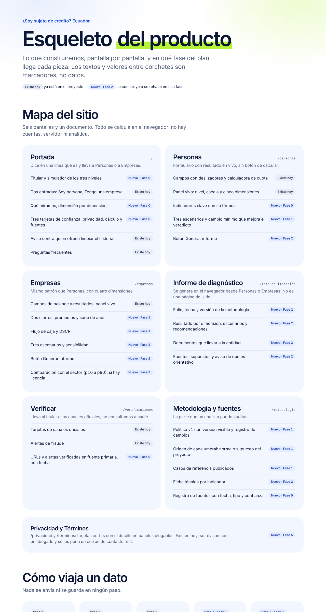
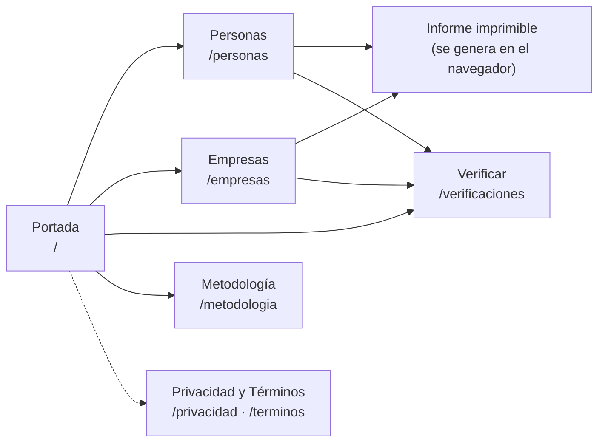
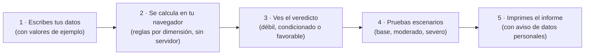
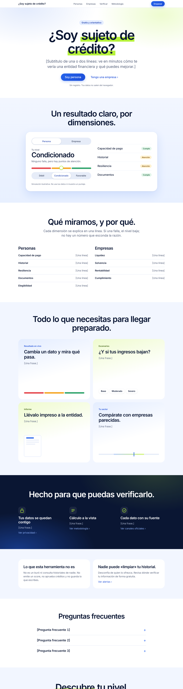
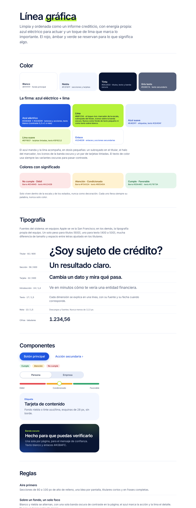

# Diseño del producto: mapa, portada y línea gráfica

Este documento resume el diseño de **¿Soy sujeto de crédito? Ecuador**: qué pantallas tiene el sitio, cómo viaja un dato, cómo es la portada «azul + lima» y qué reglas siguen los colores, la tipografía y los componentes. Las imágenes son capturas del lienzo de diseño; las fuentes están en [`../diseno/esqueleto/`](../diseno/esqueleto/) y una versión que se abre en el navegador, en [`../prototipos/esqueleto-sujeto-de-credito-ecuador.html`](../prototipos/esqueleto-sujeto-de-credito-ecuador.html).

## 1. Mapa del producto

Seis pantallas y un documento. **Todo se calcula en el navegador**: no hay cuentas, servidor ni analítica.

| Pantalla | Ruta | Qué hace |
|---|---|---|
| Portada | `/` | Dice en una línea qué es el sitio y lleva a Personas o a Empresas. |
| Personas | `/personas` | Formulario con resultado en vivo, sin botón de calcular: nivel, escala y cinco dimensiones. |
| Empresas | `/empresas` | Mismo patrón, con cuatro dimensiones, flujo de caja y DSCR. |
| Informe de diagnóstico | vista de impresión | Se genera en el navegador desde Personas o Empresas; no es una página del sitio. |
| Verificar | `/verificaciones` | Lleva al titular a los canales oficiales y avisa de fraudes; no consulta a nadie. |
| Metodología y fuentes | `/metodologia` | Lo que un analista puede auditar: umbrales con su origen, casos de referencia y fuentes. |
| Privacidad y Términos | `/privacidad`, `/terminos` | Tarjetas cortas con el detalle en paneles plegables. |

### Cómo viaja un dato

Nada se envía ni se guarda en ningún paso.

### Cómo se arma por dentro

Cuatro capas, cada una con su prueba.

| Capa | Contenido |
|---|---|
| **Datos** | Archivos JSON con fuente, fecha, tipo y confianza en cada registro. Se validan al compilar: si un dato no cumple, no se publica. Lo desconocido queda como vacío documentado. |
| **Lógica** | Reglas por dimensión y nivel global, escenarios, indicadores y percentiles sectoriales. Pruebas unitarias y casos de referencia recalculados aparte. |
| **Interfaz** | Componentes del panel vivo, escala y plegables; generador de informe imprimible. Sin scripts, tipografías ni imágenes de terceros. |
| **Calidad y entrega** | CI con tipos, pruebas, validación de datos y e2e; accesibilidad y rendimiento medidos con Lighthouse; despliegue estático con cabeceras de seguridad. |

> Las etiquetas «Existe hoy» y «Nuevo · Fase N» del lienzo reflejan el estado del 5 de noviembre de 2026. El avance real por fase está en [`plan-de-profesionalizacion.md`](plan-de-profesionalizacion.md) y en las entregas `fase*-entrega.md`.

## 2. Portada «azul + lima»

La portada se ordena en bandas que alternan blanco y niebla, con **una sola banda oscura** de contraste:

1. **Titular y entrada.** «¿Soy sujeto de crédito?» con el subrayado lima, dos botones (*Soy persona*, *Tengo una empresa*) y la frase «Sin registro. Tus datos no salen del navegador».
2. **Un resultado claro, por dimensiones.** Simulador ilustrativo del nivel (débil, condicionado, favorable) con la escala y las dimensiones, rotulado como simulación.
3. **Qué miramos, y por qué.** Las dimensiones de Personas (capacidad de pago, historial, resiliencia, documentos, elegibilidad) y de Empresas (liquidez, solvencia, rentabilidad, cumplimiento).
4. **Todo lo que necesitas para llegar preparado.** Cuatro tarjetas: resultado en vivo, escenarios, informe impreso y comparación con el sector.
5. **Hecho para que puedas verificarlo.** La banda oscura, con tres tarjetas de confianza: privacidad, cálculo a la vista y fuentes.
6. **Lo que esta herramienta no es.** No es un buró, no consulta historiales, no emite un score ni aprueba créditos; y el aviso de que nadie puede «limpiar» un historial.
7. **Preguntas frecuentes** y cierre con la invitación a descubrir el nivel.

Los textos entre corchetes del lienzo (`[Una frase.]`) son marcadores, no datos.

## 3. Línea gráfica

Limpia y ordenada como un informe crediticio, con energía propia: **azul eléctrico para actuar y un toque de lima que marca lo importante**. Los valores salen de [`src/app/globals.css`](../src/app/globals.css).

### Color

| Token | Valor | Uso |
|---|---|---|
| `--bg` | `#FFFFFF` | Fondo principal |
| `--sunken` (niebla) | `#F2F6FF` | Secciones y tarjetas |
| `--ink` (tinta) | `#0A1633` | Títulos, texto y banda oscura |
| `--muted` | `#55607A` | Texto secundario |
| `--brand` → `--brand-2` | `#2563EB` → `#1D4ED8` | Botones y acciones; texto blanco con contraste de 5,2 a 1 o más |
| `--lime` | `#B6F23A` | Marcador de la escala, subrayado del titular, íconos sobre la banda oscura. **Nunca** como texto sobre blanco ni como fondo de texto pequeño |
| `--brand-soft` / `--brand-soft-ink` | `#E4EDFF` / `#1E40AF` | Etiquetas |
| `--lime-soft` / `--lime-ink` | `#EFFBCF` / `#3F6212` | Tarjetas tintadas |
| `--link` | `#1D4ED8` | Enlaces y acciones secundarias |

**Colores con significado.** Solo viven dentro de la escala y de los estados; nunca como decoración, y cada uno va siempre con su palabra, nunca solo color.

| Estado | Barra | Texto | Fondo |
|---|---|---|---|
| No cumple · Débil | `#E5484D` | `#A1242B` | `#FDE7E7` |
| Atención · Condicionado | `#F5A524` | `#80540A` | `#FFF2D1` |
| Cumple · Favorable | `#30A46C` | `#17673A` | `#E3F5EA` |

### Tipografía

Fuentes del sistema (San Francisco en equipos Apple; la propia de cada equipo en los demás), sin fuentes de terceros. Un solo peso para títulos (600), uno para texto (400 a 500), mucha diferencia de tamaño y espacio entre letras ajustado en los titulares.

| Nivel | Tamaño / peso |
|---|---|
| Titular | 92 / 600 |
| Sección | 56 / 600 |
| Tarjeta | 32 / 600 |
| Introducción | 24 / 1,4 |
| Texto | 17 / 1,5 |
| Nota | 13 / 1,5 (nunca menos de 12,5 px) |
| Cifras | tabulares |

### Componentes

Botón principal (azul, píldora) y acción secundaria con enlace; etiquetas de estado (*Cumple*, *Atención*, *No cumple*); selector Persona / Empresa; **escala de tres tramos** con marcador de halo lima; tarjeta de contenido (fondo niebla o tinte azul/lima, esquinas de 28 px, sin borde); y la banda oscura con texto blanco y enlaces `#A5B4FC`.

### Reglas

| Regla | Qué significa |
|---|---|
| Aire primero | Secciones de 80 a 100 px de relleno, una idea por pantalla, titulares cortos y en frases completas. |
| Sobre un fondo, un solo foco | Blanco y niebla se alternan, con una sola banda oscura por página; el azul marca la acción y la lima el detalle. Nunca un tercer color de marca. |
| Orden de informe | Definiciones en dos columnas, filas con filetes finos, términos fijos (débil, condicionado, favorable) y la fuente siempre a la vista. |
| Movimiento discreto | Entrada suave al cargar y un marcador con halo lima que se desliza. Se apaga si el equipo pide reducir el movimiento. |
| Ícono de trazo | Línea de 2,4 px, azul sobre fondo claro y lima sobre la banda oscura. Sin emojis, sin ilustraciones de personas, sin logotipos de terceros. |
| Accesible por diseño | Contraste de texto de 4,5 a 1 o más, objetivos de 44 px, foco visible y significado nunca solo por color. |

## Dónde está cada cosa

| Archivo | Contenido |
|---|---|
| [`../diseno/esqueleto/`](../diseno/esqueleto/) | Fuentes del lienzo, una pantalla por archivo |
| [`../prototipos/esqueleto-sujeto-de-credito-ecuador.html`](../prototipos/esqueleto-sujeto-de-credito-ecuador.html) | Lienzo completo autocontenido (abrir en el navegador) |
| [`../prototipos/proyecto-sujeto-de-credito.html`](../prototipos/proyecto-sujeto-de-credito.html) | Prototipo del sitio en un solo archivo |
| [`../src/app/globals.css`](../src/app/globals.css) | Tokens reales de color y tipografía |
